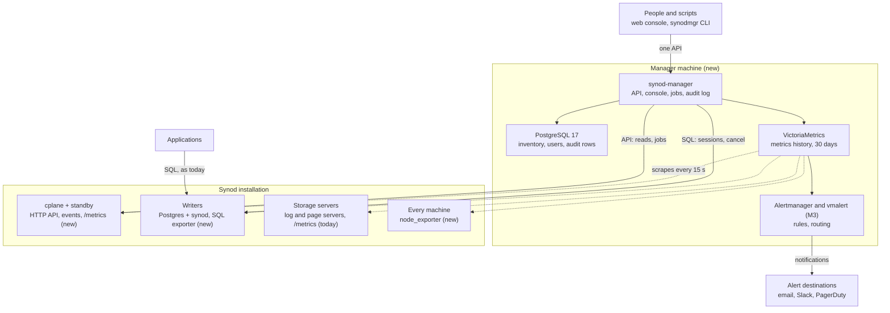

# Synod Manager: design proposal

Nov 1, 2026 · Sang · Status: proposal; all decisions and open questions confirmed Nov 1. No code yet. The live, commentable version is the Claude Doc
[Synod Manager: design proposal](https://claude.ai/artifact/FcK4GKdvwTjmN7WsXjvFGx); this file is a copy.

## Summary and decisions

Build **Synod Manager**: one service the customer runs in their own network. It shows every Synod cluster's health and performance, runs admin actions through the control plane, and raises alerts. A web console and a `synodmgr` CLI share one API, as Oracle Enterprise Manager and srvctl do.

You confirmed all four decisions below on Nov 1.

| Question | Decision | Why |
| --- | --- | --- |
| Form | Web console and CLI, both on one API; the console ships in milestone 1 | Confirmed by you on Nov 1. Every action is scriptable, and the console can never do something the CLI can't |
| Where it runs | A new VM next to the cluster, in the customer's network | Confirmed by you on Nov 1: next to the cluster it can collect every metric. Pilot machines have no inbound internet access, and Oracle RAC shops run OEM themselves. It ships with `synod-install` and runs on any Linux machine with no AWS service needed; the same build becomes a Synod-hosted cloud in 2027 |
| Who uses it | Admin and Viewer roles plus an audit log from day one; SSO (OIDC) in milestone 2 | Confirmed by you on Nov 1. Today one shared token can do everything, with no record of who did what |
| First milestone | Read-only fleet and performance views | Confirmed by you on Nov 1. Safe to give pilots early: it adds no new way to break a cluster |

## What it is, in Oracle terms

Synod Manager does for a Synod RAC fleet what Enterprise Manager, srvctl and DBCA do for Oracle RAC. Most of the data already exists in Synod; what's missing is one place that collects it, keeps its history and acts on it.

| Oracle | Synod Manager | Built on (exists today unless marked new) |
| --- | --- | --- |
| Cloud Control console | Web console: fleet, cluster, writer and storage pages | cplane API (`/v1/clusters/{name}`, `/v1/hosts`, `/v1/events`) |
| Management Agent | Collectors on every machine | Page server and log server `/metrics`; new: `node_exporter` per machine, one SQL exporter per writer |
| Repository (OMR) | Manager's own Postgres for inventory, users, audit log and alert state; a metrics store for time series | New |
| srvctl, crsctl | `synodmgr` CLI | cplane API: split, relocate, settings, restore points |
| DBCA | Create-cluster flow in the console and CLI | `POST /v1/clusters`, then `POST .../split` |
| GV$SESSION, Performance Hub | Sessions and waits across every writer | `synod.cluster_stat_activity` (writer, wait event, query per session) |
| Interconnect and gc statistics | Cache Fusion page per writer | `synod.share_stats()`: dozens of counters, such as `blocks_shipped`, `grants_asked_of_other`, `waits_for_other_transactions`, `deadlocks_across_writers` |
| Incident Manager | Alerts and incidents (milestone 3) | cplane events such as `writer_evicted`, `failover_started`, `heartbeats_missing`; new: rule engine and routing |

## Architecture

The manager runs on its own machine and reaches clusters three ways: the cplane API for inventory, events and every action; SQL to writers for live sessions and cancels; and metric scrapes. Applications keep connecting straight to the writers.

Nothing the manager does sits on the commit or page path, so losing the manager machine pauses only the views and alerts.

## Milestone 1: read-only fleet and performance views

Milestone 1 ships seven web console pages, plus the CLI's read commands on the same API, and changes nothing on any cluster. Metrics refresh every 15 s and events every 5 s; history is kept 30 days by default.

| Page | What it shows | Where the data comes from |
| --- | --- | --- |
| Fleet | Every cluster and single-writer database: writers up or evicted, control plane leader and standby, open alerts, last restore point | cplane `GET /v1/clusters/{name}`, `/v1/databases`, `/v1/hosts`, `/v1/leader`, restore points |
| Cluster | Slots and their writers (host, address, state), sharing and table groups, settings, storage layout, restore points, the cluster's event timeline | cplane API; events filtered to the cluster |
| Writer | Commits per second, connections and pooler use, commit wait for the log servers, block service busy time, CPU, memory and disk | SQL exporter on the writer; `node_exporter` |
| Cache Fusion | Per writer, per second: blocks shipped and received, grants asked of the other writers, waits for other writers' transactions, cross-writer deadlocks, full images logged, slow block service turns | `synod.share_stats()` through the SQL exporter |
| Sessions and waits | Live list of every writer's sessions, plus a history of wait events sampled every 10 s, like Oracle's ASH | `synod.cluster_stat_activity` |
| Storage | Log servers (commit lag, flush time), page servers (page read latency, WAL ingest lag, upload backlog to S3), disk space | Page server and log server `/metrics`; `node_exporter` |
| Events | One timeline of failovers, evictions, moves, setting changes and restore points across every installation | cplane `/v1/events` |

By default, the wait-event history keeps counts only (writer, wait event, user, database), not query text. Query text can hold customer data, so storing it is a setting the customer turns on.

The Cache Fusion page is the one no generic Postgres tool has. Its counters show how often pages move between writers, the cause behind the Nov 1 heavy-write result. Naming which tables and blocks are hot needs a new function (see Changes needed in Synod).

## Milestone 2: admin actions

Every action is a job: the manager shows what will happen, asks for the right confirmation, calls the cplane API once, and follows the job to its end through cplane events. The console and `synodmgr` run the same jobs.

| Action | cplane call (exists) | Confirmation |
| --- | --- | --- |
| Create a cluster, then split it into N writers | `POST /v1/clusters`, `POST .../split` | Normal |
| Change cluster settings (block service, extension lock, `max_connections`) | `PATCH .../settings` | Normal; the preview lists what applies only at restart |
| Turn the pooler on, size it | `PATCH .../settings` with `pool.*` | Normal |
| Take or list restore points | `POST` and `GET .../restore-points` | Normal |
| Relocate a writer slot to another host | `POST .../slots/{slot}/relocate` | Typed cluster name; `force` needs Admin and a reason |
| Move a table group, convert sharing | `POST .../groups/{grp}/move`, `POST .../convert` | Typed cluster name; preview states the measured pause (convert: 8–15 s with writer b down) |
| Restore into a new cluster | `POST .../restore` | Typed cluster name |
| Split storage, DR failover | `POST .../storage/split`, `POST /v1/dr/clusters/{name}/failover` | Typed cluster name and a reason |
| Single-writer databases: move, fail over, replicas, home host | `/v1/databases/{name}/...` | Typed name for failover |
| Cancel or end a session on any writer | SQL: `synod.cancel_backend`, `synod.terminate_backend` | Normal |

Three rules hold for every action:

- **One job per cluster at a time.** cplane answers 409 for most actions while another runs, but not for settings or DR; the manager queues every job per cluster instead of retrying.
- **No automatic actions.** Alerts never trigger a job, and the manager never changes real-time settings on its own, in line with "never turn off realtime by yourself".
- **Scriptable.** `synodmgr <action> --dry-run` prints the preview; `--yes --reason "..."` runs it without prompts; `--json` prints machine-readable output.

## Milestone 3: alerts

Alerts come from two sources: rules over metrics (vmalert, Prometheus rule format) and cplane events. Both go to Alertmanager, which routes them to email and Slack first, what the first design partner uses; PagerDuty, Opsgenie or a webhook follow when a customer asks. Synod Manager ships a starter pack; customers can change thresholds and add rules.

| Alert | Fires when | Severity |
| --- | --- | --- |
| Writer evicted | event `writer_evicted` | Critical |
| Failover stuck | `failover_started` with no `failover_done` within 60 s | Critical |
| Commits stopped | fewer than 2 of 3 log servers reachable | Critical |
| Page server down | its `/metrics` unreachable for 30 s | Critical |
| No control plane leader | `/v1/leader` empty for 10 s | Critical |
| Log server down | 1 of 3 unreachable for 60 s | Warning |
| Host silent | event `heartbeats_missing` | Warning |
| Control plane standby missing | only one cplane answers for 60 s | Warning |
| Recovery or takeover failed | events `recovery_failed`, `takeover_failed`, `promote_failed`, `failback_failed` | Critical |
| Failback keeps failing | event `failback_backoff` | Warning |
| Replica behind | more than 64 MB behind (the point where cplane replaces it) | Warning |
| Restore points stopped | newest restore point older than 5 minutes (they are taken every 60 s) | Warning |
| Prepared transaction stuck | a row in `synod.cluster_prepared_xacts` older than 5 minutes | Warning |
| Disk filling | under 5 GB free or over 85% used (the installer's own check) | Warning |
| Commit wait or block service slow | thresholds set from pilot baselines | Warning |

On-call scheduling stays with the customer's existing tool. Bundling one would add a product to support, and Grafana OnCall OSS, the obvious open-source choice, was archived on March 24, 2026.

## Access, audit log and SSO

People sign in to the manager, never to cplane. The manager is the only holder of each installation's cplane admin token, so its roles and audit log can't be bypassed once that token is rotated.

- **Roles.** Admin runs every action; Viewer sees every page and nothing else. Per-cluster scoping (an app team sees only its clusters) comes when a customer asks.
- **Sign-in.** Milestone 1: local accounts and API tokens for `synodmgr` and scripts. Milestone 2: SSO through OIDC (Okta, Microsoft Entra ID, Google); SAML only if a customer needs it.
- **Audit log.** One append-only row per action and per sign-in: who, when, from where, the action, its target, the request with secrets removed, the result, and the cplane event ids it caused. Each row carries a hash of the previous one, so a removed or edited row is detectable. Auditors get a read-only export (CSV or JSON).
- **Secrets.** cplane tokens and database passwords are stored encrypted. The key stays on the manager machine, readable only by its service (like the installer's secrets file today). No cloud secret store is needed; one can be plugged in later.
- **SQL access to writers.** Read-only pages use a `synod_monitor` role with `pg_monitor` rights, over TLS checked against the cluster CA (`GET /v1/ca.crt`). Cancelling or ending sessions uses a separate role, used only for Admin jobs.

## Changes needed in Synod

Thirteen small changes, none on the commit or page path. Each is read-only or a new management endpoint.

| Where | Change | Milestone |
| --- | --- | --- |
| cplane | `GET /v1/clusters` (list); today only one cluster can be read by name | 1 |
| cplane | `GET /v1/events?after=<id>&database=<name>`; today it only returns the newest N | 1 |
| cplane | `GET /metrics`: leader and standby, each host's heartbeat age, writers by state, events counted by kind | 1 |
| cplane | Report its version and API level (in `/v1/leader` or a new `/v1/version`), so the manager knows which actions a cluster supports | 1 |
| agent | Run a SQL exporter next to each writer, like the pooler: started and stopped with the compute, reading over the local socket, on a free port in the writer's block of 10 (the pooler uses +5) | 1 |
| installer | `node_exporter` on every machine; a `manager` role in the inventory; open the exporter ports to the manager machine | 1 |
| extension | A `synod_monitor` role created at install with `pg_monitor` (for other users' query text) | 1 |
| extension | `synod.hot_blocks(n)`: the most-requested blocks with table name and grant counts; `share_block_info` today needs a table and block number | 2 |
| cplane | Record the caller's job id (header `X-Synod-Job`) in the events each call causes, so audit rows link to them | 2 |
| cplane | `DELETE /v1/clusters/{name}` | 2 |
| cplane | Scoped tokens: read-only and admin | 2 |
| cplane | Token rotation without restarting cplane | 2 |
| extension | Per-table counters of blocks moved between writers | 2 |

The SQL exporter reuses what's already in the fork: Neon's collector definitions in `compute/etc/sql_exporter/` (local file cache, page reads stuck, backpressure, current LSN). The installer doesn't ship an exporter binary today. The Synod collectors are added beside them: `share_stats` counters, `pg_stat_database` commits and rollbacks, and wait-event counts from `cluster_stat_activity`.

By the standing rule, the agent change is the only one that touches a running writer's machine. It gets the full correctness suite (backup, restore, standby, logical replication, storage split) before merging.

## Packaging and deployment

The manager installs as one more role in the existing inventory, on a new VM next to the cluster, so a cluster in trouble can't take its monitoring down with it.

- **What runs on the manager machine:** `synod-manager` (API, console and job runner, written in Rust like cplane so it can share its types), a plain PostgreSQL 17 for its own state, VictoriaMetrics for metrics, and in milestone 3 vmalert and Alertmanager. All are managed by systemd units from `synod-install`, like every other service.
- **One manager, many installations.** Each installation (one cplane pair and its clusters) is added with its front-door URL, admin token and CA certificate. Scrape targets come from the cplane API, so new hosts and writers appear by themselves.
- **Off the data path.** If the manager stops, clusters keep committing and failing over; only the views and alerts pause. Milestone 1 runs one manager instance; a standby comes later, as cplane got one.
- **Sizing:** to measure on the 7-machine test layout before quoting a machine size.
- **AWS, optional.** Whether Synod integrates with AWS (Marketplace image, Secrets Manager) is undecided, so nothing in the manager depends on it. Two rules hold anyway, as Marketplace would require: no data leaves the customer's network without consent (no telemetry), and Synod staff can't reach customer machines unless the customer allows it.
- **Editions.** A paid edition, with a free Community edition beside it (Marketplace allows a free edition only beside a paid one). Proposed split: Community gets the milestone 1 views and the read-only CLI for one installation; the paid edition adds admin actions, alerts, SSO, audit export and many installations.
- **A Synod-hosted cloud in 2027.** The same binary will serve many customers. Because customer machines take no inbound connections, each customer runs a small outbound-only forwarder for metrics and events. To keep that cheap later, every row in the manager's database and every metric carries an installation id from milestone 1.
- **Code:** the private repo `sangrhee88/synodmgr`. Manager, console and CLI live there; the Synod-side changes (cplane, agent, extension, installer) stay in `synod-storage` and `stage3-neon-m1`. This design is kept in the repo as `docs/design.md`.

## Open-source pieces and licenses

Every piece shipped is under a permissive license, so the manager can be sold inside Synod without opening its code. A lawyer should confirm before the Marketplace listing, as the Marketplace notes already say for the rest of Synod.

| Piece | Used for | License |
| --- | --- | --- |
| [VictoriaMetrics](https://pkg.go.dev/github.com/VictoriaMetrics/VictoriaMetrics@v1.141.0-cluster) (single node), vmalert | Metrics store and scraping; alert rules | Apache 2.0 |
| Prometheus Alertmanager, `node_exporter` | Alert routing; host metrics | Apache 2.0 |
| [sql_exporter](https://github.com/burningalchemist/sql_exporter) | Per-writer SQL metrics, the tool Neon's collector files are written for | MIT |
| [Perses](https://github.com/perses/perses) panels (npm packages) | Charts inside the console | Apache 2.0 |
| PostgreSQL 17 | The manager's own state | PostgreSQL License |

Deliberately left out:

- **Grafana inside the console.** It is [AGPLv3](https://grafana.com/blog/2021/04/20/grafana-loki-tempo-relicensing-to-agplv3) since version 8. A customer can still point their own Grafana at the manager's metrics store.
- **Grafana OnCall OSS.** [Archived on March 24, 2026](https://grafana.com/docs/oncall/latest/set-up/open-source.md).
- **Autobase's console.** Its [production use needs a commercial license](https://github.com/autobase-tech/autobase).
- **Whole platforms (pgwatch, Percona PMM, Coroot).** Useful as references for metric queries and page layouts, but none knows writers, evictions or Cache Fusion, and each brings its own agent and database.

## Order of work and tests

Milestone 1 is about three weeks of work by my estimate; milestones 2 and 3 about two to three weeks each. Sizes are rough until the first step is done.

1. **cplane read endpoints** (about 2 days): cluster list, events after an id, `/metrics`. Unit tests in `cplane`.
2. **Collectors** (about 3 days): the agent runs a SQL exporter per writer with Neon's and the new Synod collectors; the installer adds `node_exporter`, the `manager` role and the `synod_monitor` role. Then the local correctness suite, since this is the one change on writer machines.
3. **Manager core** (about 4 days): API, its own database (installations, users, tokens, audit log), VictoriaMetrics with targets taken from cplane.
4. **Console and CLI** (about 1 to 1.5 weeks): the seven pages, and `synodmgr` read commands (`status`, `clusters`, `events`, `sessions`).
5. **Test locally**: a three-writer cluster from `local3-run.sh`, then the existing fault tests (kill, freeze, network split, machine loss), checking that each shows on the Events and Cluster pages within 10 s.
6. **Test on AWS** (asks you first; it costs money): one run on the 7-machine layout to measure the exporters' cost to throughput with the warm-cache benchmark, and to size the manager machine. Results collected before teardown; machines terminated and counted to 0.
7. **Milestone 2**: the job runner and actions, OIDC sign-in, scoped cplane tokens, job ids in events. Each action tested against a live local cluster, including a second job refused while one runs.
8. **Milestone 3**: the alert pack and Alertmanager. Each fault test must raise its alert exactly once and clear it when the cluster recovers.

## Risks and questions for you

The main risk is the exporters slowing the writers. `share_stats` reads counters in memory, but `cluster_stat_activity` asks every writer, so it is sampled every 10 s and measured in step 6. If the exporters cost more than 1% of throughput, the sampling slows down until they don't.

Other risks:

- **The manager holds every cluster's admin token.** Whoever controls it controls the fleet. Encryption at rest in milestone 1; scoped tokens in milestone 2.
- **The cplane API changes between releases.** The manager will read the cplane version and refuse actions against an API it doesn't know, while still showing pages.
- **Query text is customer data.** It stays off unless the customer turns it on (see Milestone 1).

Questions before code starts, answered Nov 1:

- [x] Is the name **Synod Manager** (`synodmgr`) right? Yes: the code lives in sangrhee88/synodmgr (private, created Nov 1).
- [x] Is the manager in the paid product only, or also in a free Community edition? Marketplace allows a free edition only beside a paid one. Answer: both, a free Community edition beside the paid one (split proposed under Packaging).
- [x] Which alert destinations and sign-in provider does the first design partner use (Slack, PagerDuty, email; Okta, Entra ID)? Answer: Slack and email for alerts. The sign-in provider is still open; OIDC covers the common ones.
- [x] Is a Synod-hosted cloud a 2027 goal, or customer-hosted only for now? Answer: yes, a 2027 goal.
- [x] OK to run a SQL exporter next to every writer? It is the only change on writer machines. Answer: yes, so each writer's performance shows on its own.
